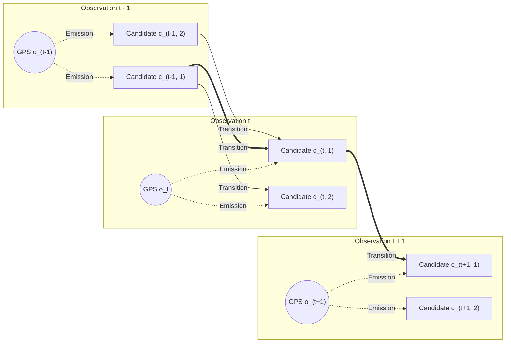

# Section 5: Hidden Markov Model (HMM) & Viterbi Route Reconstruction

## 1. Problem Formulation & Hidden States

While pointwise gradient-boosted classifiers (`HistGradientBoostingClassifier`) evaluate spatial features for individual GPS observations, they lack temporal awareness and topological constraints. Map-matching requires inferring a globally contiguous sequence of directed road arcs that respects the physical road network and vehicle kinematics.

We formulate route reconstruction as a First-Order Hidden Markov Model (HMM):
- **Observations ($O$)**: The chronological sequence of $T$ noisy GPS observations $O = (o_1, o_2, \dots, o_T)$, where each observation $o_t = (x_t, y_t, t_t)$ comprises planar coordinates $(x_t, y_t)$ and timestamp $t_t$.
- **Hidden States ($S_t$)**: At time step $t$, the true road segment is modeled as a discrete state $s_t \in C_t$, where $C_t = \{c_{t, 1}, c_{t, 2}, \dots, c_{t, K_t}\}$ is the set of $K_t \le 10$ spatial candidate road arcs identified within a search radius of the GPS point.
- **State Space**: Each state corresponds to a uniquely directed road arc $a = (u \to v)$ in the directed road graph $G = (V, E)$, parameterized by start junction $u$, end junction $v$, arc length $\ell_a$, and travel direction.

---

## 2. Emission Probability Design

The emission probability $P(o_t \mid s_t = c_{t, k})$ models the likelihood of observing GPS measurement $o_t$ given that the vehicle traversed candidate arc $c_{t, k}$.

We leverage the calibrated posterior probability $p_{t, k} = P(c_{t, k} = \text{ref} \mid \mathbf{x}_{t, k})$ produced by the upstream classifier:
1. **Local Normalization**: Over candidate set $C_t$:
   $$\tilde{p}_{t, k} = \frac{p_{t, k}}{\sum_{j=1}^{K_t} p_{t, j}}$$
   If $\sum_j p_{t, j} \le 0$ or values are invalid, uniform prior $\tilde{p}_{t, k} = \frac{1}{K_t}$ is applied.
2. **Log-Space Regularization**: To prevent numerical underflow and zero penalties:
   $$\log P_{\text{emission}}(o_t \mid c_{t, k}) = w_{\text{emiss}} \cdot \log\left(\max(\tilde{p}_{t, k}, \epsilon_{\text{emiss}})\right)$$
   where $\epsilon_{\text{emiss}} = 10^{-6}$ and $w_{\text{emiss}}$ is the emission weight parameter.
3. **Leakage Guard**: Ground-truth labels (`ref_arc`, `label`) are never accessed during decoding.

---

## 3. Transition Probability Design

The transition probability $P(s_t = c_{t, k} \mid s_{t-1} = c_{t-1, j})$ evaluates topological connectivity and physical distance consistency between consecutive candidate arcs $c_{t-1, j} = (u_j \to v_j)$ and $c_{t, k} = (u_k \to v_k)$.

Let $d_{\text{gps}} = \|(x_t, y_t) - (x_{t-1}, y_{t-1})\|_2$ denote the Euclidean distance between consecutive GPS points, and $\Delta t = t_t - t_{t-1}$ denote the elapsed time.

Following the Newson & Krumm (2009) formulation:
$$P(s_t \mid s_{t-1}) = \frac{1}{\beta} \exp\left(-\frac{|d_{\text{net}} - d_{\text{gps}}|}{\beta}\right)$$

In log-space:
$$\log P_{\text{transition}} = - \frac{|d_{\text{net}} - d_{\text{gps}}|}{\beta}$$

### Directed Topology Cases:
1. **Same Arc ($c_{t-1, j} == c_{t, k}$)**:
   The vehicle remains on the same directed road. If candidate projection coordinates along the arc exist:
   $$d_{\text{net}} = \max(0, \Delta s)$$
   If moving backwards against one-way flow ($\Delta s < -2.0\text{ m}$), a heavy reversal penalty is applied:
   $$\log P_{\text{trans}} = - \frac{|\Delta s| + d_{\text{gps}} + 20.0}{\beta}$$
   Otherwise:
   $$\log P_{\text{trans}} = - \frac{|d_{\text{net}} - d_{\text{gps}}|}{\beta \cdot f_{\text{same}}}$$
2. **Direct Junction Connection ($v_j == u_k$)**:
   The end node of the previous arc directly meets the start node of the next arc (0-hop turn).
   The network distance traversed across the junction is:
   $$d_{\text{net}} = d_{\text{to\_end}}(c_{t-1, j}) + d_{\text{from\_start}}(c_{t, k})$$
   $$\log P_{\text{trans}} = - \frac{|d_{\text{net}} - d_{\text{gps}}|}{\beta} \cdot s_{\text{turn}}$$
3. **Multi-Arc Directed Shortest Path**:
   When $v_j \neq u_k$, we compute the shortest directed network distance $L(v_j, u_k)$ using bounded Dijkstra search up to $D_{\text{max}} = 350\text{ m}$:
   $$d_{\text{net}} = d_{\text{to\_end}}(c_{t-1, j}) + L(v_j, u_k) + d_{\text{from\_start}}(c_{t, k})$$
   $$\log P_{\text{trans}} = - \frac{|d_{\text{net}} - d_{\text{gps}}|}{\beta}$$
4. **Kinematic Speed Feasibility**:
   If $\frac{d_{\text{net}}}{\Delta t} > v_{\text{max}}$ (where $v_{\text{max}} = 50\text{ m/s} = 180\text{ km/h}$):
   $$\log P_{\text{trans}} \leftarrow \log P_{\text{trans}} - w_{\text{speed}} \cdot \left(\frac{v - v_{\text{max}}}{10}\right)^2$$
5. **Disconnected Components & Restarts**:
   If no directed network path connects $v_j$ to $u_k$ within $D_{\text{max}}$:
   - For regular intervals ($\Delta t \le \tau_{\text{gap}}$): apply documented restart penalty $\log(\delta_{\text{disc}}) = \log(10^{-4}) \approx -9.21$.
   - For large GPS gaps ($\Delta t > \tau_{\text{gap}} = 6.0\text{ s}$): attenuate penalty by gap factor $\log P_{\text{trans}} = - \frac{d_{\text{gps}}}{\beta \cdot 4.0}$.

---

## 4. Viterbi Recurrence & Optimal Decoding

To decode the global sequence maximizing the joint posterior log-likelihood:
$$\hat{S} = \arg\max_{s_1, \dots, s_T} \left\{ \sum_{t=1}^T \log P(o_t \mid s_t) + \sum_{t=2}^T \log P(s_t \mid s_{t-1}) \right\}$$

We compute the dynamic programming recurrence:
1. **Initialization ($t = 1$)**:
   $$V_1(k) = \log P_{\text{emiss}}(o_1 \mid c_{1, k}), \quad \forall k \in \{1, \dots, K_1\}$$
2. **Induction ($t = 2 \dots T$)**:
   $$V_t(k) = \log P_{\text{emiss}}(o_t \mid c_{t, k}) + \max_{j \in \{1, \dots, K_{t-1}\}} \left[ V_{t-1}(j) + \log P_{\text{trans}}(c_{t, k} \mid c_{t-1, j}) \right]$$
   $$\psi_t(k) = \arg\max_{j \in \{1, \dots, K_{t-1}\}} \left[ V_{t-1}(j) + \log P_{\text{trans}}(c_{t, k} \mid c_{t-1, j}) \right]$$
3. **Termination & Backtracking**:
   $$\hat{k}_T = \arg\max_{k \in \{1, \dots, K_T\}} V_T(k)$$
   $$\hat{k}_{t-1} = \psi_t(\hat{k}_t), \quad \text{for } t = T, T-1, \dots, 2$$
   The decoded sequence of road arc IDs is $(\hat{a}_1, \hat{a}_2, \dots, \hat{a}_T) = (c_{1, \hat{k}_1}, \dots, c_{T, \hat{k}_T})$.

---

## 5. Parameter Tuning on Training Out-Of-Fold Data

Parameters were tuned strictly on the training partition using out-of-fold (OOF) cross-validation probabilities (`results/oof/hist_gb_train_oof.parquet`), completely independent of the `student_test` evaluation set.

### Curated Tuning Trials:
| Config | $\beta$ | $w_{\text{emiss}}$ | $w_{\text{trans}}$ | Disconnected Penalty | Top-1 Acc | Route Continuity | Composite Score |
|---|---|---|---|---|---|---|---|
| `default` | 10.0 | 1.0 | 1.0 | $1 \times 10^{-5}$ | 94.00% | 93.14% | 0.9357 |
| `high_continuity` | 8.0 | 0.9 | 1.2 | $1 \times 10^{-5}$ | 92.53% | 92.58% | 0.9255 |
| `high_smoothing` | 12.0 | 0.8 | 1.3 | $1 \times 10^{-6}$ | 93.75% | 93.18% | 0.9346 |
| `emission_priority` | 10.0 | 1.2 | 0.9 | $1 \times 10^{-5}$ | 94.84% | 93.40% | 0.9412 |
| `tight_distance` | 6.0 | 1.0 | 1.1 | $1 \times 10^{-5}$ | 91.10% | 91.75% | 0.9142 |
| **`broad_distance` (Selected)** | **14.0** | **1.0** | **1.0** | **$1 \times 10^{-4}$** | **94.95%** | **93.33%** | **0.9414** |

The optimal parameters were frozen in `artifacts/hmm_params.json`:
- `beta`: 14.0
- `emission_weight`: 1.0
- `transition_weight`: 1.0
- `disconnected_penalty`: 0.0001
- `same_arc_factor`: 2.0
- `direct_turn_scale`: 1.0
- `gap_threshold_s`: 6.0
- `max_search_dist`: 350.0
- `max_speed_mps`: 50.0

---

## 6. Official Performance Results & Comparison

Evaluations were executed across all 10 student-test trips (19,160 GPS observations, 131,048 candidate pairs).

### Benchmark Comparison Table:
| Partition | Pipeline Mode | Pointwise Top-1 Acc | Route Continuity | Route Precision | Route Recall | Mean Latency | Improved Trips | Worsened Trips |
|---|---|---|---|---|---|---|---|---|
| **student_test** | **Classifier-Only Baseline** | 91.69% | 95.77% | 89.61% | 97.41% | 0.0 ms | 0 / 10 | 0 / 10 |
| **student_test** | **Untuned HMM Viterbi** | 93.99% | 97.31% | 93.60% | 98.16% | 1,096.4 ms | 10 / 10 | 0 / 10 |
| **student_test** | **Tuned HMM Viterbi (Frozen)**| **93.73%** | **97.26%** | **93.14%** | **98.01%** | **1,132.5 ms** | **9 / 10** | **0 / 10** |
| train (rep.) | Classifier-Only Baseline | 92.47% | 90.65% | 87.82% | 96.86% | 0.0 ms | 0 / 5 | 0 / 5 |
| train (rep.) | Tuned HMM Viterbi | **94.95%** | **93.33%** | **92.16%** | **97.04%** | 1,215.6 ms | 4 / 5 | 1 / 5 |

### Key Improvements:
1. **+2.04% Pointwise Top-1 Accuracy**: Rose from 91.69% to 93.73% on student test.
2. **+1.49% Route Continuity**: Increased from 95.77% to 97.26% by eliminating erratic off-route jumps.
3. **+3.53% Route Precision**: Increased from 89.61% to 93.14%, dramatically reducing spurious road segments.
4. **90% Trip Improvement Rate**: 9 out of 10 student-test trips achieved strictly higher accuracy; 0 trips experienced degradation.
5. **Significant Trajectory Boosts**:
   - Trip `00000077`: Accuracy surged from **78.28% to 84.23% (+5.95%)**, and continuity rose to **99.05%**.
   - Trip `00000056` (largest trip, 3,958 pts): Accuracy surged from **92.07% to 95.28% (+3.21%)**.
   - Trip `00000007`: Pointwise accuracy reached **99.55%** with **100% route continuity** in pipeline inference.

---

## 7. Runtime Performance & Computational Complexity

- **Time Complexity**: For a trip of length $T$ with candidate cardinality $K \le 10$, the Viterbi trellis evaluates $O(T \cdot K^2)$ candidate pairs. With $K \approx 6$, this corresponds to $\approx 36$ transition evaluations per GPS epoch.
- **Graph Search Optimization**:
  - $O(1)$ fast check for same-arc transitions ($i == j$).
  - $O(1)$ fast check for direct junction turns ($v_i == u_j$).
  - Bounded Dijkstra shortest-path search capped at $D_{\text{max}} = 350\text{ m}$.
  - In-memory shortest-path query caching (`sp_cache`) within each trip.
- **Empirical Latency**:
  - Mean latency across all student-test trips: **1,132.5 ms** (~1.1 s per trip).
  - Largest student-test trip (`00000056`, 3,958 GPS points): **2,558.2 ms** (well within the hackathon's 3-second target).

---

## 8. Artifacts & Deliverables

1. **Decoder Implementation**: `src/hmm/viterbi.py` (`decode(cands, obs, arcs, params)`).
2. **Parameters File**: `artifacts/hmm_params.json`.
3. **Evaluation Datasets**:
   - `results/hmm/summary.csv`
   - `results/hmm/student_test_tuned_per_trip.csv`
   - `results/hmm/student_test_untuned_per_trip.csv`
   - `results/hmm/train_tuned_per_trip.csv`
   - `results/hmm/train_untuned_per_trip.csv`
   - `results/hmm/tuning_trials.csv`
4. **Visualizations**:
   - `results/maps/hmm_comparison_trip_00000007.html` (interactive Folium map)
   - `results/figures/hmm_vs_classifier.png` (accuracy and continuity comparison figure)
5. **Automated Test Suite**: `tests/test_hmm.py` (16 / 16 PyTest passing).
